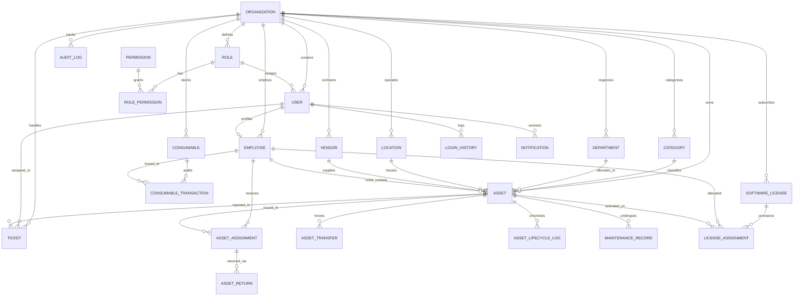

# Enterprise ITAM - Database Entity Relationship Diagram (ERD)

## Key Entities & Constraints
1. **Organization**: Multi-tenancy root entity with isolated branding, currency, and settings.
2. **Asset**: Core entity with unique constraints on `assetId`, `assetTag`, `barcode`, and `serialNumber`.
3. **AssetAssignment**: Immutable historical log of all handovers with accessories and digital signatures.
4. **AssetLifecycleLog**: Append-only event history (`PURCHASE`, `RECEIVING`, `ALLOCATION`, `MAINTENANCE`, `RETURN`, `DISPOSAL`).
5. **SoftwareLicense**: SAM tracker maintaining `quantityPurchased` vs. `quantityUsed` quotas.
6. **Consumable**: Inventory items with minimum alert thresholds and inward/outward movement ledgers.
7. **AuditLog**: Security log capturing operator username, IP address, timestamp, old values, and new values.
