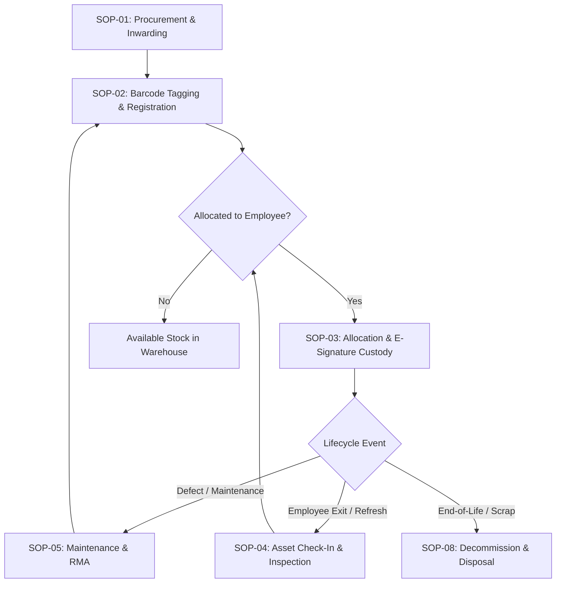

# Standard Operating Procedure (SOP): IT Asset Management Platform

**Document Version:** 1.0.0  
**Effective Date:** October 2026  
**Classification:** Confidential - Internal IT Operations & Governance  
**Author:** IT Systems & Infrastructure Engineering Team  
**Approved By:** Chief Information Officer (CIO) / Head of IT Infrastructure  

---

## 1. Purpose & Scope

### 1.1 Purpose
This Standard Operating Procedure (SOP) governs the day-to-day administration, physical tracking, digital chain of custody, software license compliance, maintenance, and disaster recovery processes for all enterprise IT assets managed within the IT Asset Management (ITAM) platform.

### 1.2 Scope
This procedure applies to:
- All company-owned computing hardware (laptops, desktops, workstations, servers, network appliances).
- Mobile devices, tablets, and peripherals (monitors, docking stations, chargers).
- IT consumables (cables, keyboards, mice, adapters, RAM modules).
- Software licenses, SaaS subscriptions, digital product keys, and maintenance contracts.
- All IT staff, warehouse administrators, field technicians, internal auditors, and end-user employees.

---

## 2. Role-Based Access Control (RBAC) & Governance Matrix

Access to the ITAM system is enforced via cryptographic JSON Web Tokens (JWT) mapped to granular role permissions:

| Role Name | Scope of Authority | Permitted Operations | Restricted Actions |
|---|---|---|---|
| **SUPER_ADMIN** | Global Enterprise | Full read/write across all modules, branding customization, custom fields definition, disaster recovery backups, system diagnostics, user role provisioning. | None. |
| **ADMIN** | IT Department Management | Asset CRUD, employee allocation/deallocation, software license management, consumables tracking, reports export, barcode label generation. | Custom field architecture deletion, system-wide database restore. |
| **TECHNICIAN** | Field & Desk Support | Hardware check-in/out, repair ticket logging, maintenance completion, barcode scanning, inspection status updates. | User role modification, license purchase contract deletion. |
| **AUDITOR** | Compliance & Finance | Read-only access to all master registries, depreciation schedules, audit logs, handover compliance certificates, regulatory exports. | Any data mutation (create, edit, delete). |
| **VIEWER** | Departmental Read-only | View departmental asset allocations, category summaries, warranty statuses. | Data mutation, configuration modifications. |
| **EMPLOYEE** | Self-Service Portal | View assigned hardware, review custody handover certificates, electronically sign receipts, submit support & repair tickets. | Access to other employees' assets, admin menus. |

---

## 3. Core Standard Operating Procedures

---

### SOP-01: Asset Procurement, Delivery Inspection & Receiving

1. **Physical Receiving:**
   - Unbox incoming hardware in the designated IT staging area.
   - Match delivery Challan / Invoice against the Purchase Order (PO).
   - Inspect shipping box for physical impact, water damage, or broken tamper seals.
2. **Serial Number Verification:**
   - Record manufacturer serial numbers (Dell Service Tag, Apple Serial, Lenovo Serial).
   - Verify that physical labels match the vendor delivery invoice.
3. **DOA (Dead-on-Arrival) Triage:**
   - Connect power, power on the device, enter UEFI/BIOS setup to verify hardware configuration (CPU, RAM, NVMe capacity).
   - If defective, immediately flag vendor RMA and reject asset before marking received.

---

### SOP-02: Barcode Tagging, Hardware Spec Registration & Custom Attributes

1. **Asset Tag Generation:**
   - Navigate to **Assets Master Registry** (`/assets`).
   - Click **+ Add Asset**.
   - Input Hardware details:
     - **Name:** e.g., `MacBook Pro 16" M3 Max` or `ThinkPad T14s Gen 4`
     - **Category:** Select Laptop, Desktop, Server, Monitor, etc.
     - **Serial Number:** Physical manufacturer serial number.
     - **Purchase Cost & Currency:** Enter invoice cost (auto-formatted according to company branding currency).
     - **Warranty End Date & Provider:** e.g., Dell ProSupport Plus until 2029.
     - **Custom Dynamic Fields:** Fill required department-specific custom fields (e.g., Asset Owner, MAC Address, Processor Model).
2. **Physical Label Affixing:**
   - Select the newly registered asset in `/assets` and click **Print Barcode / QR Label** (`Printer` icon).
   - Print the standard 38mm x 25mm polyester thermal transfer barcode label with Code 128 barcode and asset identification tag.
   - Affix label to the bottom chassis (laptops) or rear I/O panel (desktops/monitors). Ensure surface is cleaned with isopropyl alcohol before application.

---

### SOP-03: Employee Allocation, Digital E-Signature & Handover Certificate PDF

1. **Initiating Allocation:**
   - Navigate to **Asset Allocation Center** (`/allocations`).
   - Click **+ New Allocation**.
   - Select the **Target Asset** (must be in `AVAILABLE` status).
   - Select the **Employee** (from active HR directory).
   - Specify accessories handed over (e.g., Original Charger, Docking Station, USB-C Dongle, Laptop Sleeve).
   - Submit allocation. Asset status immediately transitions to `ASSIGNED`.
2. **Digital Custody Sign-Off (In-Person or Remote):**
   - Click the **Sign & Acknowledge** icon on the active allocation record.
   - Display the asset details, serial numbers, and condition to the employee.
   - Prompt the employee to draw their physical signature on the HTML5 e-signature canvas (touchscreen or mouse).
   - Click **Submit Signed Acceptance**.
3. **Handover Certificate Archiving:**
   - Click **Download Certificate** (`PDF` icon).
   - The platform auto-generates a tamper-proof PDF Handover Certificate containing:
     - Corporate logo & branding header.
     - Asset specification & manufacturer serial number.
     - Date/time stamp of custody transfer.
     - High-resolution vectorized employee signature.
   - The certificate is stored permanently in the database audit record and accessible by the employee via their `/portal` dashboard.

---

### SOP-04: Asset Check-In, Physical Condition Inspection & Return Workflow

1. **Trigger Events:**
   - Employee resignation / termination.
   - Hardware upgrade / refresh cycle (every 36 months).
   - Transition to temporary leave.
2. **Execution Steps:**
   - Navigate to **Asset Allocation Center** (`/allocations`).
   - Locate the active assignment and click **Return Asset**.
   - Select return condition:
     - `GOOD` - No visible damage; return directly to `AVAILABLE` stock pool.
     - `DAMAGED` - Physical damage detected; route to **Maintenance** (`/maintenance`).
     - `NEEDS_REPAIR` - Hardware failure (keyboard, screen, motherboard); route to vendor RMA.
   - Verify return of all recorded accessories (power bricks, cords, dongles). Missing accessories must be noted in the return logs.
   - Submit return. Asset status changes to `AVAILABLE` or `MAINTENANCE`.

---

### SOP-05: Preventive Maintenance, Repair Scheduling & Vendor RMA Tracking

1. **Logging Maintenance:**
   - Navigate to **Maintenance & Repairs** (`/maintenance`).
   - Click **Schedule Maintenance**.
   - Select Asset Tag, Title, Issue Description, Priority (`LOW`, `MEDIUM`, `HIGH`, `CRITICAL`), and Scheduled Date.
2. **Technician Workflow:**
   - Mark task status to `IN_PROGRESS` upon opening service ticket.
   - Record vendor RMA reference number (if sent for OEM depot warranty repair).
   - Upon resolution, enter:
     - **Repair Cost:** Material & labor cost.
     - **Resolution Notes:** Replacement part details (e.g., replaced 1TB NVMe drive, reapplied thermal paste).
     - **Return Condition:** Verified operational state.
   - Complete maintenance ticket. The platform automatically adds this record to the asset's permanent lifecycle history.

---

### SOP-06: Software License Allocation, SAM Compliance & True-up Auditing

1. **License Key Registration:**
   - Navigate to **Software License Registry** (`/licenses`).
   - Click **+ Add License**.
   - Input Software Name (e.g., `Microsoft 365 E5`, `JetBrains All Products Pack`, `Autodesk AutoCAD`).
   - Select License Type (`PER_SEAT`, `ENTERPRISE`, `OEM`, `OPEN_SOURCE`).
   - Enter purchased seat quantity, license key, expiration date, and vendor.
2. **Seat Assignment:**
   - Click **Assign Seat** on the target software license.
   - Link employee name or specific asset ID.
   - The system validates that `Allocated Seats < Total Purchased Seats`. If seats are exhausted, assignment is prevented.
3. **License Revocation:**
   - When an employee departs or no longer requires software access, revoke their assigned seat to return it to the available pool.

---

### SOP-07: Consumables & Bulk Peripherals Stock Management

1. **Registering Consumables:**
   - Navigate to **Consumables & Peripherals** (`/consumables`).
   - Create consumable items (e.g., `Cat6 Patch Cable 2m`, `Logitech Wireless Mouse M185`, `65W USB-C Power Adapter`).
   - Define **Minimum Stock Threshold** (e.g., minimum 10 units).
2. **Stock Inwarding & Dispatching:**
   - To add stock: Click **+ Stock In** and enter quantity and unit cost.
   - To dispatch: Click **- Issue to Employee** and specify quantity and recipient employee.
3. **Automated Low-Stock Alerts:**
   - When total remaining stock drops below the defined threshold, the item triggers a warning badge in the dashboard and logs an alert for procurement reordering.

---

### SOP-08: Asset End-of-Life, Decommissioning, Data Sanitization & Disposal

1. **Decommission Criteria:**
   - Hardware exceeds maximum operational lifecycle (typically 5 years).
   - Repair cost exceeds 60% of replacement value.
   - Obsolescence or incompatibility with enterprise security standards (e.g., lack of TPM 2.0).
2. **NIST SP 800-88 Data Sanitization Protocol:**
   - **Step 1:** Remove asset from production network.
   - **Step 2:** Execute cryptographic erase (Cryptographic Wipe) or NIST 800-88 Rev 1 Clear/Purge overwrite using enterprise erasure tools.
   - **Step 3:** Record cryptographic erasure verification hash.
3. **Disposal Registration:**
   - Edit Asset in `/assets` and set status to `DISPOSED`.
   - Update condition to `SCRAP` or `SOLD_TO_EMPLOYEE`.
   - Record disposal vendor certificate of destruction in the asset notes.

---

### SOP-09: Disaster Recovery, Database Backup & Cloud Sync Schedule

The platform features an integrated **Disaster Recovery Center** (`/settings` -> Disaster Recovery) enabling zero-data-loss recovery.

#### 1. Backup Schedule & Retention Policy

| Tier | Backup Type | Frequency | Target Destination | Retention Period |
|---|---|---|---|---|
| **L1 (Daily)** | SQLite / PostgreSQL Snapshot | Every 24 hours (02:00 UTC) | Local encrypted archive (`./backups/`) | 14 Days |
| **L2 (Weekly)** | Full ITAM Bundle (.itam-backup / .zip) | Every Sunday (03:00 UTC) | Off-site Cloud Storage (OneDrive / Google Drive / AWS S3) | 8 Weeks |
| **L3 (Monthly)** | Audit Log & Financial Archive | 1st of every month | Immutable Cold Archive (WORM Storage) | 7 Years (Statutory) |

#### 2. Manual Backup Creation
1. Log in as `SUPER_ADMIN`.
2. Navigate to **Customization & Settings** -> **Disaster Recovery**.
3. Under **Create Snapshot**, click **Generate Full Backup (.itam-backup)**.
4. The system packages:
   - SQLite Database (`dev.db` / `production.db`)
   - Company Branding & Custom Field Definitions
   - Uploaded Assets & PDF Certificates
   - System configuration & encryption salts
5. Save the timestamped backup file to secure secondary storage.

#### 3. Disaster Recovery Restoration Procedure
In the event of hardware crash, ransomware attack, or server migration:
1. Provision clean host machine with Node.js 18+ and deploy repository.
2. Launch backend service.
3. Open the ITAM platform in a browser and navigate to **Disaster Recovery**.
4. Click **Select Backup Archive** and upload the latest valid `.itam-backup` or `.zip` file.
5. Click **Initiate Disaster Recovery Restore**.
6. The backend validates schema integrity, restores relational tables, rebuilds full-text search indices, and restarts the service.
7. Verify restore via `/api/v1/health` and log in with your administrative credentials.

---

### SOP-10: Super Admin White-Labeling, Custom Fields Governance & System Diagnostics

1. **Enterprise Branding & White-Labeling:**
   - Navigate to `/settings` -> **Branding & Localization**.
   - Configure:
     - **Company Name:** Appears across all navigation headers and browser title tags.
     - **Corporate Logo:** Upload PNG/SVG asset (rendered in header and PDF certificates).
     - **Primary Accent Colors:** Dynamic CSS variable mapping.
     - **Default Currency & Code:** `USD ($)`, `EUR (€)`, `GBP (£)`, `INR (₹)`, `JPY (¥)`.
     - **Date Format:** `YYYY-MM-DD`, `DD/MM/YYYY`, or `MM/DD/YYYY`.
2. **Custom Dynamic Field Builder:**
   - Navigate to `/settings` -> **Custom Field Engine**.
   - Create new business attributes without database schema migrations:
     - Field Types supported: `TEXT`, `NUMBER`, `BOOLEAN`, `DATE`, `DROPDOWN_SELECT`.
     - Target Entities: Assets, Employees, Licenses.
     - Validation: Mark mandatory or optional.
3. **Live System Diagnostics & Health Telemetry:**
   - Navigate to `/settings` -> **System Diagnostics**.
   - Inspect:
     - Memory RSS / Heap Allocated.
     - Node.js runtime process uptime.
     - SQLite Write-Ahead-Log (WAL) connection status.
     - Telemetry timestamp & background scheduler health.

---

## 4. Emergency Incident & Quick Reference Cheat Sheet

| Symptom / Incident | Immediate Action | Escalation Contact |
|---|---|---|
| **Lost or Stolen Laptop** | 1. Navigate to `/assets`, find asset tag, update status to `LOST_STOLEN`. 2. Remotely wipe device via MDM (Intune / Jamf). 3. File incident report and attach police complaint number to notes. | IT Security Officer / InfoSec Team |
| **Accidental Asset Deletion** | 1. Do NOT restart the database service. 2. Open Disaster Recovery center and restore the most recent pre-incident `.itam-backup` snapshot. 3. Cross-reference audit logs in `/audit-logs`. | Super Admin / Database Administrator |
| **Handover Signature Missing** | 1. Access `/allocations`. 2. Filter by `Unsigned Handover`. 3. Notify employee to log in to `/portal` and complete digital signature. | IT Desk Lead |
| **Port Conflict on Server (Port 5000 / 3000)** | 1. Check process holding port: `netstat -ano \| findstr :5000` 2. Terminate rogue process or adjust `PORT=5001` in `backend/.env`. | Systems Administrator |

---

*End of Standard Operating Procedure. Approved for production use across all enterprise entities.*
